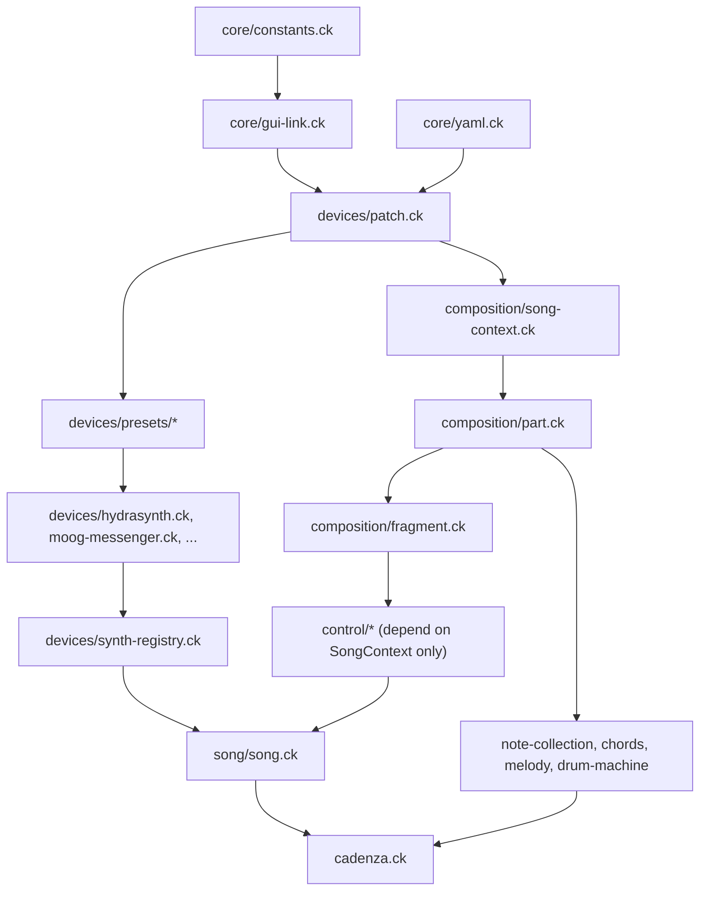

# Cadenza Refactoring Plan: Readability & Maintainability

> Status: **Completed** — Phases 0–10 implemented and verified (`./scripts/check.sh`).

## 1. Where things stand

| File | Lines | What's in it |
|---|---:|---|
| `framework/patch.ck` | 3,782 | `Patch` base, 6 synth subclasses, 3 preset classes, 3 preset collections, **about 2,600 lines of preset data** |
| `gui/index.html` | 3,147 | about 800 lines CSS, 90 lines markup, about 2,100 lines JS |
| `framework/song.ck` | 2,759 | `Song` (about 1,800 lines), `Part`, `FragmentTransition`, `Fragment`, `ControlChange`, `LaunchControl` |
| `framework/yaml.ck` | 889 | `YamlNode`, `YamlParser` |
| `gui/server.js` | 700 | Express/WS/OSC bridge, patch-set file manager, preset-catalog regex parser |
| `framework/note-collection.ck` | 443 | `NoteCollection`, `LSystemNotes` |

Baseline: `chuck -s test/run-all.ck` → **116 passed, 0 failed**.

### Main problems

1. **God classes.** `Song` handles tempo, the device registry, synth swapping, patch-set YAML I/O, transport, mute/solo, preset browsing, the keyboard loop, and 27 OSC handlers. `LaunchControl` handles MIDI input, LEDs, terminal printing, writing `dashboard.md`, and building the JSON state broadcast.
2. **Branching on synth type everywhere.** Code like `if (uiName == "V3") … else if (uiName == "Hydrasynth") … else if (uiName == "SH-4d") …` shows up in about 12 places:
   - `initDevicesFromParts`, `setDeviceSynth`, `keyboardLoop`, `handleOscDevice`, `handleOscSetPreset`, `LaunchControl.handleButtonDown`
   - `setNext/PrevPreset[Category]`, `setPresetByName`
   - `createEmptyPatchForSynth`, `createDefaultPatchForSynth`, `resolveMidiChannelForSynth`, `broadcastState`

   Adding a seventh synth means editing every one of them.
3. **Copy-pasted logic.**
   - The "select device N" block (set `currentDevice`, retarget `hydraEvents`, sync preset cursor) is repeated **6 times**.
   - `HydraPresetCollection`, `SH4dPresetCollection` and `V3PresetCollection` are near-identical copies of the same next/prev/category logic.
   - The 27 `handleOsc*` functions share the same `while(true){ e => now; while(e.nextMsg()) … }` loop and the same `idx` bounds check.
   - Three separate `OscSend` objects to `localhost:9450` (`Patch.noteXmit`, `Fragment.xmit`, `LaunchControl.xmit`).
4. **Synth-specific code in the base class.** `Patch` has `programChangeHydra`, `programChangeS1`, `programChangeSH4d*` and `programChangeV3GrandPiano`, so the base class has to know about every subclass.
5. **Data mixed in with code.** About 2,600 lines of preset tables sit inside `patch.ck`, and `gui/server.js` **regex-scrapes `patch.ck`** to build the GUI catalog. The Moog category list is duplicated in `patch.ck` and `server.js`. `gui/presets.js` is a stale generated one-line catalog that the page still loads.
6. **Misleading names and side effects.**
   - `printDevices()` actually means "state changed": it redraws the terminal, writes `dashboard.md` *and* broadcasts OSC.
   - `presets` (V3) sits next to `hydraPresets` and `sh4dPresets`.
   - `hydraEvents` is the generic keyboard-to-device MIDI forwarder.
   - `chords.ck` contains `ChordProgression`, which is a `Part`.
7. **A protocol workaround.** `handleOscNextFragment` decodes `__cmd__:setSynth:` / `setChannel:` / `setPreset:` strings, even though real `/cadenza/setSynth`, `/setChannel` and `/setPreset` endpoints already exist.
8. **Magic numbers.** OSC ports 9449/9450, CC numbers 7/10/71/74, LaunchControl notes 41/73/104–110, and LED colors `0x3c`/`0x0F` are scattered as literals.

---

## 2. ChucK constraints that shape the split

I tested these against the installed **ChucK 1.5.5.5** (scratch tests, not guesses):

| Constraint | Consequence |
|---|---|
| `@import` **rejects cycles** (`@import error -- cycle detected`) | Classes that reference each other (`Song` ↔ `Part`, `Song` ↔ `Fragment`, `Song` ↔ `LaunchControl`) **can't simply move to separate files**. |
| A base class in an earlier file, overridden in a later file, **does dispatch dynamically** | **Workaround for cycles:** lower layers depend on a *base class* (`SongContext`) holding the state and empty "virtual" hooks; `Song extends` it later. This is ChucK's substitute for interfaces/forward declarations. Verified. |
| Subclass instances in an array literal **can be assigned to a base-typed static array** (`[new HydraPreset(..)] @=> static Preset @ items[]`) and downcast with `$` | A single generic `Preset` / `PresetCollection` can serve every synth. Verified. |
| `@import` does not run top-level code | Data files must keep their tables inside class bodies (as they do today). |
| Imports dedupe by resolved path | An umbrella `cadenza.ck` that re-imports everything is safe. |
| `chuck --syntax file.ck` **fully type-checks** without running (it still exits 0, so grep stderr for `error`) | Gives a cheap "do all 54 songs still compile" check that never opens MIDI or OSC. |
| `YamlNode.ParseFile` uses `YamlParser`, and `YamlParser` builds `YamlNode`s | These two must **stay in one file** (or `ParseFile` moves to `YamlParser`). |

---

## 3. Target layout

```text
framework/
  cadenza.ck                     # umbrella: the ONE import song scripts need
  core/
    constants.ck                 # Ports, CC numbers, synth UI names, LaunchControl note map
    gui-link.ck                  # Single shared OscSend → :9450 (notes, transitions, state)
    yaml.ck                      # YamlNode + YamlParser (unchanged; cyclic pair)
  devices/
    patch.ck                     # Patch base: MIDI I/O, CC, generic sendProgramChange(msb, lsb, pc)
    presets/
      preset.ck                  # Preset (program, bank, code, name, category)
      preset-collection.ck       # Shared cursor/next/prev/category/find logic
      generated/                 # GENERATED from presets/catalog.json, do not edit
        hydrasynth-presets.ck
        sh4d-presets.ck
        v3-presets.ck
        moog-banks.ck
    hydrasynth.ck
    moog-messenger.ck
    roland-s1.ck
    roland-sh4d.ck
    behringer-rd6.ck
    v3-grand-piano.ck
    synth-registry.ck            # factory + channel-assignment rules (replaces 3 if/else chains)
  composition/
    song-context.ck              # SongContext: tempo, rootNote, durations, devices, hooks
    part.ck                      # Part (probability rhythms)
    fragment.ck                  # FragmentTransition, Fragment
    note-collection.ck           # NoteCollection
    lsystem-notes.ck             # LSystemNotes
    chords.ck                    # Chord
    chord-progression.ck         # ChordProgression
    melody.ck                    # Melody, AleatoricMelody, SequentialMelody
    drum-machine.ck              # DrumMachine
  control/
    midi-mapper.ck               # (was midi-events.ck)
    launch-control.ck            # ControlChange + LaunchControl (input + LEDs only)
    keyboard-control.ck          # KBHit loop
    osc-control.ck               # OSC receive + dispatch to Song methods
    state-broadcaster.ck         # JSON state + fragment graph → GUI
    terminal-display.ck          # printDevices table + dashboard.md writer
  song/
    mixer.ck                     # mute/solo state machine (operates on devices[])
    patch-set-store.ck           # patch-set dir/.default/YAML load & save
    song.ck                      # Song extends SongContext: wiring + transport + public API
  # TEMPORARY back-compat shims, deleted in Phase 10 once all songs are migrated:
  song.ck, chords.ck, melody.ck, patch.ck, midi-events.ck, note-collection.ck
                                 # each just `@import`s its new location(s)

presets/
  catalog.json                   # SINGLE SOURCE OF TRUTH for all synth presets + synth metadata
tools/
  gen-presets.js                 # catalog.json → framework/devices/presets/generated/*.ck
```

### Import layering (no cycles)



### Breaking the cycles with `SongContext`

`SongContext` (in `composition/`) holds everything that `Part`, `Fragment` and the controllers *read*, and declares no-op hooks for what they *call*:

```chuck
public class SongContext {
    float BPM; dur beat; int rootNote; string name;
    Patch @ devices[16]; Patch @ currentDevice;
    int muteMode, soloMode, allMode;
    static int golden, isPaused, shuttingDown, debug;
    int restartRequested;

    fun dur whole() { ... }  fun dur quarter() { ... }   // durations live here
    fun void advance(dur d) {}                           // overridden by Song
    fun void notifyStateChanged() {}                     // was launchControl.printDevices()
    fun void selectDevice(int idx) {}
    fun void stepPreset(int delta) {} fun void stepPresetCategory(int delta) {}
    fun void toggleMute(Patch p) {} fun void toggleSoloPatch(Patch p) {}
    fun void toggleMuteMode() {} fun void toggleSoloMode() {}
    fun void shutdown() {}
}
```

Fragment-aware state (`currentParts`, `currentFragment`, `queuedFragment`, `loopFragment`, `startFragment`) can't live in `SongContext`, because `Part` is defined after it. That leaves two options:

- **(a) Recommended:** add a thin `SongState extends SongContext` in `composition/song-state.ck`, imported after `fragment.ck`, that adds those fields. Controllers and the broadcaster take `SongState @`, and `Song extends SongState`.
- (b) Type them as `Object @` and downcast. Rejected: hard to read.

`Part.play(SongContext song)` and `Fragment.play(SongState song)` keep their current call sites, because a `Song` is passed where a base type is expected.

---

## 4. Key design changes (beyond moving code)

### 4.1 Polymorphic patches: remove the `uiName` branching

Add virtual hooks to `Patch`. Defaults are no-ops; each synth overrides the ones it supports:

```chuck
// Patch
fun PresetCollection presets() { return null; }        // per-synth collection
fun void applyPreset(Preset p) {}                       // send PC + update name/bank/program
fun void syncPresetCursor() {}                          // replaces 6 copied blocks
fun void stepPreset(int delta)    { /* generic via presets() */ }
fun void stepCategory(int delta)  { /* generic via presets() */ }
fun int  selectPresetByName(string name) { ... }
fun string declaration() { return ""; }                 // the "Hydrasynth h(...)" echo line
fun void writeStateJson(...) {}                         // SH-4d tone vs channel quirk lives in RolandSH4d
```

- `MoogMessenger` overrides `stepPreset`/`stepCategory` with its bank×program arithmetic, and `selectPresetByName` with the legacy `"<Category> Program: N"` / `"Bank: B Program: P"` parsing that currently sits in `Song.setPresetByName`.
- `RolandSH4d` overrides `selectPresetByName` (its fallback to `resolvePreset` and re-sync of the other SH-4d channels).
- The synth-specific `programChange*` helpers move out of `Patch` into their subclasses. `Patch` keeps one `sendProgramChange(int msb, int lsb, int program)` helper (pass `-1` to skip a CC).

`Song.setNextPreset` and its five siblings then become one-liners: `currentDevice.stepPreset(+1);`.

### 4.2 `SynthRegistry`: one table for synth metadata

Replace `createEmptyPatchForSynth`, `createDefaultPatchForSynth` and `resolveMidiChannelForSynth` with one table-driven class:

| uiName | factory | default preset | channel rule |
|---|---|---|---|
| `Moog` | `MoogMessenger` | bank 1 / prog 1 | fixed 0 |
| `Hydrasynth` | `Hydrasynth` | `A001` | fixed 0 |
| `S-1` | `RolandS1` | 1 / 1 | fixed 2 |
| `SH-4d` | `RolandSH4d` | — | first free in 0..3 |
| `V3` | `V3GrandPiano` | `Grand Piano Vienna` | first free in 0..15 |
| `RD-6` | `BehringerRD6` | — | keep current |

ChucK can't take function pointers, so the factory is still a single `if` chain, but it is the **only** one. Channel rules and default presets become data: they are generated from the `synths` block of `presets/catalog.json` (§4.4) into `generated/synth-table.ck`, so ChucK and the GUI can't disagree about the channel conventions in `AGENTS.md`.

### 4.3 Generic `Preset` + `PresetCollection`

- `Preset { program, bank, code, name, category }`. `HydraPreset`, `SH4dPreset` and `V3Preset` stay as **thin subclasses** (constructor only) so the data files and the server-side scraper keep working unchanged at first.
- `PresetCollection` holds `Preset @ items[]` plus the cursor logic, written once. Each synth's collection only provides its data, and SH-4d adds its `(bank, program)` matching.
- `normalizePresetName` (`"` → `'`) moves into the base class, so every synth gets it.

### 4.4 Preset data: one JSON file feeds ChucK and the GUI

**Decision:** `presets/catalog.json` is the only hand-edited source for preset data.

```jsonc
{
  "synths": {
    "V3":         { "class": "V3GrandPiano",  "fixedChannel": null, "maxChannels": 16, "defaultPreset": "Grand Piano Vienna" },
    "Hydrasynth": { "class": "Hydrasynth",    "fixedChannel": 0,    "maxChannels": 1,  "defaultPreset": "A001" },
    "SH-4d":      { "class": "RolandSH4d",    "fixedChannel": null, "maxChannels": 4 },
    "S-1":        { "class": "RolandS1",      "fixedChannel": 2,    "maxChannels": 1 },
    "Moog":       { "class": "MoogMessenger", "fixedChannel": 0,    "maxChannels": 1 },
    "RD-6":       { "class": "BehringerRD6",  "fixedChannel": null, "maxChannels": 1 }
  },
  "moogBanks": ["Messenger", "Classic Bass", "...16 names"],
  "presets": {
    "Hydrasynth": [{ "program": 0, "bank": 0, "code": "A001", "name": "Sawpressive GD", "category": "A" }],
    "SH-4d":      [{ "program": 0, "bank": 0, "name": "...", "category": "..." }],
    "V3":         [{ "program": 0, "bank": 0, "name": "Grand Piano Vienna", "category": "Grand Piano" }]
  }
}
```

How each side consumes it:

- **GUI / server:** `server/preset-catalog.js` simply `require`s the JSON (adding the Moog list built from `moogBanks`). The regex scraping of `patch.ck` is deleted. The synth list, channel rules and default presets also come from `synths`, so the GUI's channel auto-assignment and `#warningModal` logic read the same data ChucK does.
- **ChucK:** ChucK has no JSON reader, so `node tools/gen-presets.js` turns the JSON into data-only classes in `framework/devices/presets/generated/` (`hydrasynth-presets.ck`, `sh4d-presets.ck`, `v3-presets.ck`, `moog-banks.ck`, and `synth-table.ck` with the channel rules for `SynthRegistry`).
  - Generated files get a `// GENERATED from presets/catalog.json — do not edit` header and are **committed**, so running a song never needs Node.
  - `scripts/check.sh` re-runs the generator and fails if `git diff --exit-code framework/devices/presets/generated` shows drift.
  - The generator escapes `"` and `\` for ChucK string literals (some names contain `"` and backticks).

**One-time migration:** a throwaway script extracts today's `new HydraPreset(...)` / `SH4dPreset` / `V3Preset` tables from `patch.ck` into `catalog.json`, reusing the regexes already in `server.js`. Before deleting the old data, confirm the generated ChucK arrays match the old ones entry for entry (count and every field).

**Alternatives considered:**
- *Parsing JSON at ChucK runtime:* needs a new JSON parser in ChucK, and parsing about 2,500 entries at every start is likely slow. Rejected.
- *Parsing YAML via `YamlParser` at runtime:* same startup cost. Rejected.

**Delete `gui/presets.js`** and its `<script>` tag. The WebSocket `presets` message, now served from the JSON, replaces it.

### 4.5 Split `Song` by responsibility

| New unit | Takes from `Song` |
|---|---|
| `song/patch-set-store.ck` (`PatchSetStore`) | `getPatchSetDir/File`, `readDefaultPatchSetMeta`, `loadConfig`, `saveConfig`, `createAndSavePatchSet`, `loadPatchSet`, `setPatchSetMetadata`, `save/loadDeviceConfigs`, `save/loadSongConfig` |
| `song/mixer.ck` (`Mixer`) | `updateEffectiveMuteStates`, `start/endMuteMode`, `mute/unMutePatch`, `start/endSoloMode`, `set/unsetSoloPatch`, `toggleMute`, `toggleSoloPatch`, `toggleMuteMode`, `toggleSoloMode` (state: `soloPatch`, `mutedPatches`; operates on a `Patch[]`, so it is **easy to unit-test**) |
| `control/osc-control.ck` (`OscControl`) | `oscControlLoop` and all 27 `handleOsc*` |
| `control/keyboard-control.ck` | `keyboardLoop` |
| `song/song.ck` (`Song`) | constructor/wiring, transport (`play`, `pause`, `resume`, `restart`, `advance`, `playParts`…), fragment queueing, device replacement (`replaceDevice` and its BFS over fragments), `selectDevice`, `shutdown` |

Expected size of `Song`: about 600–700 lines, down from about 1,800.

### 4.6 Less OSC handler boilerplate

ChucK can't pass handler functions, but a generic dispatcher removes the shared loop and bounds checks:

```chuck
// One shred per event, one switch for all of them:
fun void listen(OscEvent e, string cmd) {
    while (true) { e => now; while (e.nextMsg()) dispatch(cmd, e); }
}
fun void dispatch(string cmd, OscEvent e) {
    if (cmd == "volume")      { withDevice(e.getInt()) @=> Patch p; if (p != null) { e.getInt() => p.volume; ... } }
    else if (cmd == "cutoff") { ... }
    ...
    song.notifyStateChanged();
}
fun Patch withDevice(int devIdx1Based) { ... bounds check once ... }
```

Each handler shrinks from about 15 lines to 1–3. Also **retire the `__cmd__:` workaround** inside `nextFragment`. Do this in two steps to keep the wire protocol backwards compatible (see AGENTS.md §4):

1. Make sure the GUI/server send the real `/cadenza/setSynth|setChannel|setPreset` messages.
2. In a later release, remove the decoding branch from ChucK.

### 4.7 Split `LaunchControl` (input, display, broadcast)

- `LaunchControl`: MIDI input, button/CC routing, LEDs. Note numbers move to `constants.ck` (e.g. `LC_SELECT_BASE = 41`, `LC_MUTE_BASE = 73`, `LC_PREV_CAT = 104`).
- `TerminalDisplay`: the ANSI device table plus `write_markdown_panel` (`dashboard.md`).
- `StateBroadcaster`: `broadcastState`, `broadcastGraph`, `escJson`. Uses the shared `GuiLink` sender, and asks each `Patch` to describe itself (`writeStateJson`) instead of special-casing SH-4d.
- `Song.notifyStateChanged()` calls display then broadcaster. Rename every `launchControl.printDevices()` call site; there are dozens.

### 4.8 Small cleanups

- **Approved renames** (applied in the phase that touches each one):

  | Old | New |
  |---|---|
  | `LaunchControl.printDevices()` | `Song.notifyStateChanged()` |
  | `Song.presets` / `hydraPresets` / `sh4dPresets` | removed (each synth's `Patch.presets()`); the static arrays become `V3Presets.items`, `HydrasynthPresets.items`, `SH4dPresets.items` |
  | `Song.hydraEvents` | `Song.midiThru` |
  | `framework/midi-events.ck` | `framework/control/midi-mapper.ck` |
  | `Patch.noteXmit`, `Fragment.xmit`, `LaunchControl.xmit` | `GuiLink.send` (shared) |
  | `write_markdown_panel()` | `TerminalDisplay.writeDashboardMarkdown()` |
  | `handControlChange()` (typo) | `handleControlChange()` |
- Move field declarations to the top of each class. `Song` currently declares `restartRequested`, the preset collections and `currentDevice` in the middle of the method list.
- Use one consistent brace style in ChucK (the codebase mixes K&R and Allman), and normalize CRLF line endings (`\r\r\n` appears in `server.js`).
- Add a short header comment to every new file: purpose, what it imports, what imports it.

### 4.9 GUI (`gui/`)

The no-build vanilla setup stays, but `index.html` can be split into static files that Express already serves:

```text
gui/
  index.html            # markup only (about 100 lines)
  css/dashboard.css     # current <style> block
  js/state.js           # chuckState, ws connection, message routing
  js/devices-table.js   # table, knobs, sliders, inline editing
  js/modals.js          # shutdown/warning/open/preset-category/patch-set modals
  js/keyboard.js        # shortcuts
  js/piano-roll.js      # song scroll visualizer
  js/fragment-graph.js  # cytoscape panel
  js/main.js            # boot
```

- **Decision: native ES modules** (`<script type="module" src="js/main.js">`), still with no build step. Reasons: each file declares its dependencies with `import`/`export` instead of relying on load order and globals; module scope stops the roughly 90 top-level functions from colliding; and Express already serves `.js` with the right MIME type. The existing `// ─── Section ───` banners mark the cut points.
- **Consequence: remove the inline handlers.** Module functions aren't global, so the 45 inline `onclick=` / `onchange=` / `onblur=` attributes (some built inside `innerHTML` template strings) must go. Replace them with **event delegation**: `data-action="openPresetModal"` (plus `data-dev="3"` etc.) and one `click`/`change` listener per container that looks up the handler in an `actions` map. This also makes the dynamically rendered device table easier to read.
  - Migration order: first move the code to modules temporarily exposing `window.x = x` for the inline handlers (behavior unchanged, easy to verify), then convert handlers to `data-action` file by file and drop the `window` exports.
- Cytoscape stays a classic `<script>` (it defines the global `cytoscape`) loaded before the module entry point.
- Validation: `node --check` on each module plus the existing `vm.Script` approach (from AGENTS.md), and a browser smoke test of every modal, knob, keyboard shortcut, the piano roll and the graph panel.
- `server.js`: split into `server/patch-sets.js` (file manager and YAML serializer), `server/preset-catalog.js`, `server/osc-bridge.js`, and a slim `server.js`. Replace the `switch` of pass-through commands (`device`, `golden`, `play`, …) with a lookup table `{ device: ['/cadenza/device', 'i'], ... }`.
- Put the OSC address list in **one shared doc** (`docs/osc-protocol.md`) listing every `/cadenza/*` message, its argument types and direction. Right now it lives only in `oscControlLoop` and the server `switch`.

---

## 5. Testing & safety net (do this first)

1. **Compile gate for every song:** add `scripts/check.sh`:
   ```bash
   chuck -s test/run-all.ck
   for f in music/*.ck; do chuck --syntax "$f" 2>&1 | grep -q error && echo "FAIL $f"; done
   node --check gui/server.js gui/server/*.js gui/js/*.js
   node tools/gen-presets.js && git diff --exit-code framework/devices/presets/generated   # generated files up to date
   ```
   `--syntax` type-checks without running, so no MIDI ports or OSC binding are touched.
2. **New unit tests** that become possible once the code is split:
   - `test-mixer.ck`: mute/solo state transitions.
   - `test-preset-collection.ck`: next/prev/category wraparound, name normalization, SH-4d `(bank, program)` lookup.
   - `test-synth-registry.ck`: channel auto-assignment rules (Moog/Hydra → 0, S-1 → 2, SH-4d first free in 0..3 / abort, V3 first free in 0..15).
   - `test-moog-preset-names.ck`: `"Hard Lead: 12"`, legacy `"Hard Lead Program: 12"`, and `"Bank: 5 Program: 12"`.
3. **Update `MockSong`** to extend the new `Song`. Better still, have most tests target `SongContext`/`SongState`, which open no hardware at all.
4. Keep `test/test-yaml.ck` standalone, but consider adapting it to `Assert` and adding it to `run-all.ck`.

---

## 6. Phased execution

Each phase is one commit or PR. **Gate after every phase:** `scripts/check.sh` is green, and a manual smoke test of one live song plus the dashboard passes.

| # | Phase | Risk | Notes |
|---|---|---|---|
| 0 | Safety net: `scripts/check.sh`, new tests for current mute/solo and preset-step behavior | none | Locks in current behavior before moving code |
| 1 | **Preset catalog → JSON:** one-time extraction into `presets/catalog.json`; write `tools/gen-presets.js`; generate `devices/presets/generated/*.ck` and delete the hand-written tables from `patch.ck`; `server.js` reads the JSON (no more regex); delete `gui/presets.js` | low–med | Diff old vs generated arrays entry for entry; about 2,600 lines leave `patch.ck` |
| 2 | **Split `patch.ck`** into base + one file per synth; `framework/patch.ck` becomes a temporary shim | low | No behavior change |
| 3 | Generic `Preset`/`PresetCollection`; add `Patch` virtual hooks; delete all the `uiName` if/else chains; add `selectDevice()` | **medium** | Biggest readability win; covered by Phase 0 tests |
| 4 | `SynthRegistry` (factory + channel rules from `generated/synth-table.ck`); GUI channel logic reads `synths` from the JSON | low–med | ChucK and GUI now share one set of rules |
| 5 | Introduce `SongContext`/`SongState`; move `Part` and `Fragment` to `composition/` | medium | Watch the static fields (`golden`, `isPaused`, `shreds`) |
| 6 | Extract `Mixer`, `PatchSetStore`, `KeyboardControl`, `OscControl`; rename `hydraEvents` → `midiThru` | medium | `OscControl` binds :9449; keep exactly one instance |
| 7 | Split `LaunchControl` → `TerminalDisplay` + `StateBroadcaster`; shared `GuiLink`; `constants.ck`; rename `printDevices` → `notifyStateChanged` | low–med | Check the JSON payload byte-for-byte against the old version |
| 8 | `cadenza.ck` umbrella; migrate **all** 54 `music/*.ck` scripts and the tests to `@import "../framework/cadenza.ck"` (scriptable `sed`) | low | Verify with `grep -L cadenza.ck music/*.ck` (should list nothing) |
| 9 | GUI: split `server.js` into `server/*`; split `index.html` into `css/` + ES modules in `js/` (step A: modules with temporary `window` exports; step B: inline handlers → `data-action` delegation); write `docs/osc-protocol.md` | low–med | `node --check` + browser smoke test after each step |
| 10 | **Delete the back-compat shims** (`framework/song.ck`, `chords.ck`, `melody.ck`, `patch.ck`, `midi-events.ck`, `note-collection.ck`); remove the `__cmd__:` workaround; update `docs/framework.md`, `docs/creating-music.md` and the AGENTS.md repo map | low | Only after Phase 8 shows zero shim users and no running session predates the change |

> [!IMPORTANT]
> Live-session caution (AGENTS.md §4): phases 5–7 change what `Song` binds to (OSC :9449, MIDI ports). Never restart a running `chuck` or `node server.js` to test; use `--syntax` and the mock-based tests, and do live verification only when you're ready.

---

## 7. Expected result

| Metric | Before | After (approx.) |
|---|---:|---:|
| Largest ChucK file | 3,782 | about 1,100 (a preset data file) / about 700 (code) |
| `Song` class | about 1,800 lines | about 650 |
| `uiName == "…"` dispatch sites | about 12 | 1 (`SynthRegistry`) |
| Copies of "select device" logic | 6 | 1 |
| Preset collection implementations | 3 | 1 |
| `OscSend` to :9450 | 3 | 1 |
| Places to edit when adding a new synth | about 10 across 4 files | 1 new `devices/<synth>.ck` + entries in `presets/catalog.json` + 1 factory line |
| Preset data sources | 3 (`patch.ck`, `server.js` Moog list, stale `presets.js`) | 1 (`presets/catalog.json`) |
| Imports per song script | 3–4 | 1 |

## 8. Decisions (2026-11-15)

1. **Preset source of truth:** a single `presets/catalog.json` feeds both sides. The server reads it directly; ChucK gets committed, generated `.ck` data files (§4.4).
2. **Back-compat shims:** temporary only. They are deleted in Phase 10, once Phase 8 has migrated every song and test.
3. **GUI modules:** native ES modules, with inline handlers replaced by `data-action` event delegation (§4.9).
4. **Renames:** approved; see the table in §4.8.
